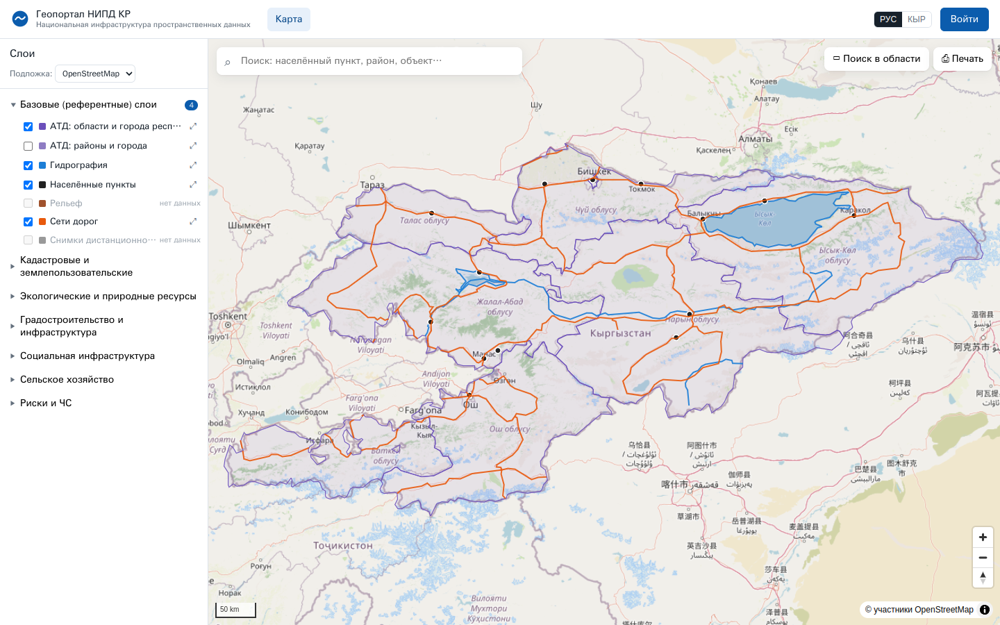
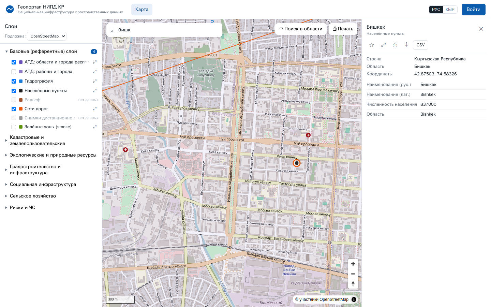
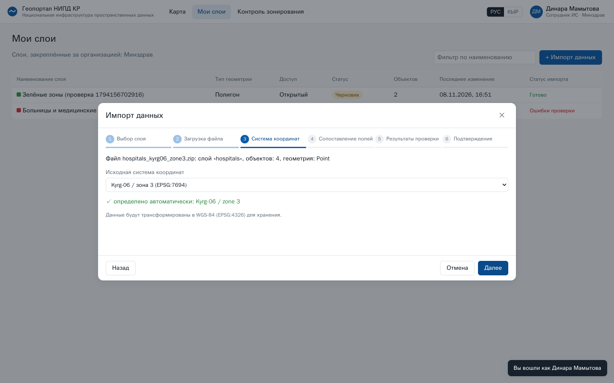
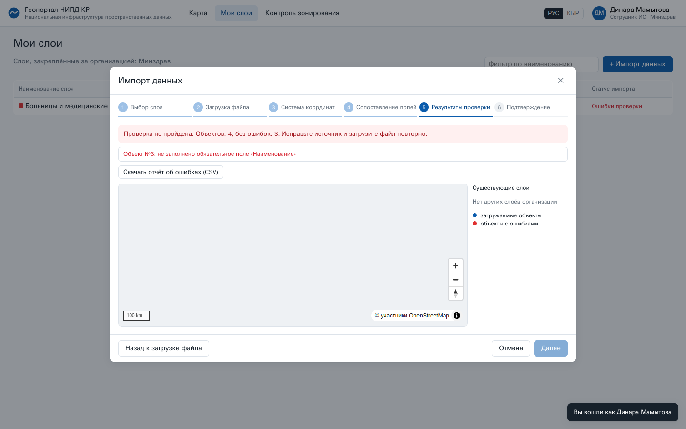
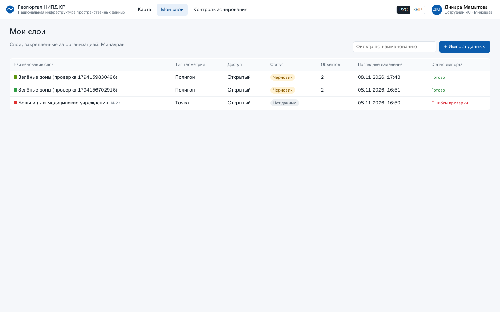
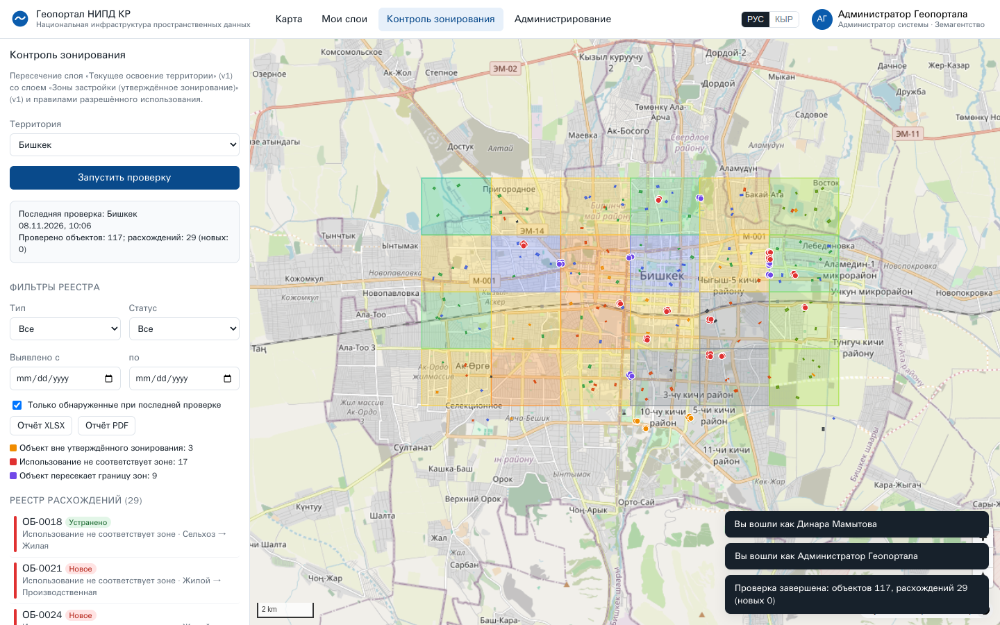

# Сценарий показа MVP (~15 минут)

Раздел 7 документации MVP «Геопортал НИПД КР». Сквозной срез: карта → поиск → вход → импорт → публикация →
редактирование → контроль зонирования → отчёт → администрирование.

## Подготовка

```bash
docker compose down -v                                # чистая БД: демо-слои загрузятся заново
SEED_ZONING_CHECK=false docker compose up --build -d  # → http://localhost:8088
```

`SEED_ZONING_CHECK=false` отключает начальную проверку зонирования, которую сидер иначе выполняет при первом старте.
Тогда на шаге 6 первый запуск проверки покажет **29 новых** расхождений. При значении по умолчанию (`true`) реестр
уже заполнен, и запуск покажет 29 расхождений, из них 0 новых. Флаг действует только на пустой БД.

Готовность: в логе бэкенда (`docker compose logs backend`) 7 строк `Seeded …` (328 объектов) и
`Initial zoning check skipped (SEED_ZONING_CHECK=false)`.

Вход для любой роли: «Войти» → «Войти через Infocom ID» → выбрать демо-учётную запись (вход эмулируется).
Перед каждым следующим входом — «Выход».

Подготовьте файлы из `demo-data/samples/`: `hospitals_kyrg06_zone3.zip` и `green_zones_with_error.geojson`.

---

## 1. Без входа: карта, слои, поиск (≈3 мин)

1. Откройте http://localhost:8088.
   **Ожидается:** карта Кыргызстана на подложке OSM, слева дерево слоёв — 7 тем, 34 слоя (закрытые слои анонимному
   пользователю не видны). Видны области, районы, населённые пункты, дороги, гидрография, зоны и текущее освоение
   территории Бишкека. 
2. Включите и выключите пару слоёв в дереве, откройте легенду «Текущее освоение территории».
   **Ожидается:** слои появляются и пропадают сразу, легенда показывает классы застройки.
3. Наберите в поиске «бишк» и выберите «Бишкек».
   **Ожидается:** первый результат — «Бишкек», слой «Населённые пункты». Карта приближается к объекту, открывается
   карточка с атрибутами и координатами. 
   (см. также `acceptance/screenshots/FR-SRCH-03.png`, `FR-SRCH-03-card.png`)
4. «Поиск в области» → обведите прямоугольник вокруг Бишкека → экспорт CSV.
   **Ожидается:** список только тех объектов, которые попали в область, они подсвечены на карте. CSV скачивается с
   колонками `Наименование;Слой;Долгота;Широта`. (`acceptance/screenshots/FR-SRCH-04.png`)

## 2. Отказ во входе — Эрмек Бекмуратов (≈1 мин)

Войдите как «Эрмек Бекмуратов» (бывший специалист Минтранса, `is_active = false` в Е-Кызмат).
**Ожидается (БП-1):** вход отклонён с текстом
«Доступ к служебному контуру недоступен для вашей учётной записи. Обратитесь к администратору Геопортала».
Отказ записывается в журнал аудита (его покажем на шаге 7).

## 3. Импорт с определением СК и проверкой — Динара Мамытова, Минздрав (≈3 мин)

1. Войдите как «Динара Мамытова» → «Мои слои» → слой «Больницы и медицинские учреждения» → импорт файла
   `demo-data/samples/hospitals_kyrg06_zone3.zip`.
2. Шаг выбора системы координат.
   **Ожидается:** СК определилась сама — **EPSG:7694** (KYRG-06, зона 3), выбирать вручную не нужно.
   
3. Сопоставление полей → проверка.
   **Ожидается:** проверка блокирует импорт с ошибкой
   «Объект №3: не заполнено обязательное поле «Наименование»». Импорт дальше не идёт, пока ошибка не исправлена.
   

## 4. Новый слой, автоисправление геометрии, публикация — Динара Мамытова (≈2 мин)

1. Там же: «Создать новый слой» (например, «Зелёные зоны», доступ — открытый) → импорт
   `demo-data/samples/green_zones_with_error.geojson`.
2. Проверка без флажка «Исправлять невалидную геометрию автоматически».
   **Ожидается:** ошибка самопересечения полигона.
3. Включите флажок и повторите проверку → импорт.
   **Ожидается:** 2 объекта без ошибок, импорт выполнен — создана новая версия слоя (черновик).
   
4. «Опубликовать» → подтвердить.
   **Ожидается:** слой появился в дереве слоёв на публичной карте; после выхода он виден и без входа.

## 5. Оперативный слой — Бакыт Осмонов, МЧС (≈1 мин)

1. Войдите как «Бакыт Осмонов» → карта → «✎ Редактор» → слой «Оползни, лавины».
2. «Ввести координаты (WGS-84)»: например, долгота `74.62`, широта `42.84` → сохранить, заполнить наименование.
   **Ожидается:** карта приближается к точке, объект сохранён. Слой оперативный, поэтому правка публикуется **сразу**,
   без отдельного шага «Опубликовать»: точку видно всем пользователям, в том числе без входа (проверить в другом
   окне браузера в режиме инкогнито). (`acceptance/screenshots/FR-GIS-03.png`)

## 6. Контроль зонирования — Айгерим Садыкова, Минархстрой (≈3 мин)

1. Войдите как «Айгерим Садыкова» → «Контроль зонирования» → территория «Бишкек» → «Запустить проверку».
   **Ожидается:** проверено 117 объектов, **29 расхождений**: 17 «использование не разрешено в зоне»,
   3 «объект вне зон», 9 «объект пересекает несколько зон». С `SEED_ZONING_CHECK=false` все 29 — новые.
   Повторный запуск — 0 новых. 
2. Реестр: отфильтруйте по типу.
   **Ожидается:** 17 / 3 / 9 по типам, расхождения подсвечены на карте. (`acceptance/screenshots/FR-TER-04.png`)
3. Откройте расхождение → смените статус (например, «Нарушение подтверждено»), добавьте комментарий и файл в поле
   «Акт / документ» → «Сохранить».
   **Ожидается:** «Статус расхождения сохранён»; в истории запись с автором, временем и приложенным актом.
   (`acceptance/screenshots/FR-TER-03.png`)
4. «Отчёт XLSX» и «Отчёт PDF».
   **Ожидается:** оба файла скачиваются и открываются; в XLSX на листе расхождений 29 строк, PDF — 2 страницы,
   кириллица читается.

## 7. Администрирование — Администратор Геопортала (≈2 мин)

1. Войдите как «Администратор Геопортала» → «Администрирование».
   **Ожидается:** счётчики (пользователи, слои, объекты, импорты, расхождения, события и **отказы за 24 ч ≥ 1**).
2. «Журнал событий».
   **Ожидается:** все действия показа — входы, импорт, создание и публикация слоя, создание объекта, проверка
   зонирования, смена статуса, выгрузка отчётов — и **«Отказ во входе»** Эрмека Бекмуратова с результатом `denied`.
   Фильтр «Результат» → `denied` оставляет только отказ. (`acceptance/screenshots/FR-AUTH-06.png`)
3. «Правила зонирования» → разрешите в матрице «зона × использование» одно из запрещённых сочетаний (например,
   сельское хозяйство в жилой зоне) → «Сохранить правила».
   **Ожидается:** правила сохранены, изменение записано в журнал.
4. Вернитесь в «Контроль зонирования» → Бишкек → «Запустить проверку».
   **Ожидается:** расхождений типа «использование не разрешено» стало меньше 17, всего — меньше 29.

---

**Известные ограничения, о которых стоит знать на показе** (подробно — `docs/acceptance/mvp-verification.md`):
мобильная вёрстка не адаптирована (показывать на десктопе); подложек только две — OSM и «без подложки»;
вход через Infocom ID и Түндүк эмулируется.
